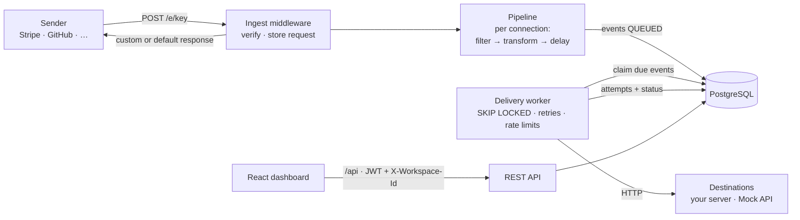

# EaseWebhook

**A webhook gateway: receive, verify, filter, transform and reliably deliver webhooks, with full visibility into every request.**

[Live app](https://easewebhook.vercel.app) · [API health](https://easewebhook.onrender.com/.well-known/health)

EaseWebhook sits between the services that *send* webhooks (Stripe, GitHub, Shopify, Slack, …) and the servers that
*receive* them. Senders post to a stable EaseWebhook URL; EaseWebhook checks the signature, stores the request, runs it
through your rules, and delivers it to one or more destinations, retrying until it succeeds. Every request, event and
delivery attempt is kept and searchable, so nothing is lost when your server is down and every failure can be replayed.

> Inspired by [Hookdeck](https://hookdeck.com). Built from scratch as a full-stack learning project.

---

## Features

### Ingestion
- **Source URLs**: each source gets a public endpoint `/e/{key}` (sub-paths forwarded to destinations).
- **33 source types**: Webhook, Publish API (API key), HTTP (CORS-enabled for browsers/SDKs), plus **30 providers with
  native signature verification**: Stripe, GitHub, Shopify, Paddle, Razorpay, Cashfree, Facebook, Instagram,
  WhatsApp, Slack, Discord, Twitch, Clerk, Resend, Standard Webhooks / Svix, Zendesk, Typeform, Segment, Linear, GitLab,
  Bitbucket, WooCommerce, Mailgun, Intercom, Calendly, Vercel, Sentry, Cal.com, Postmark, Pipedrive.
- **Provider handshakes** handled automatically (Meta `hub.challenge`, Slack `url_verification`, Discord PING with
  Ed25519, Twitch callback verification). Timestamped schemes reject replays older than 5 minutes.
- **Generic verification** for any sender: HMAC, API key or basic auth.
- **Custom responses**: reply to the sender with your own JSON / text / XML body instead of the default acknowledgement.
- Rejected requests (bad signature, wrong method) are stored with the reason, so you can see *why* something failed.

### Routing & rules
- **Connections** link a source to a destination; one source can fan out to many destinations.
- Ordered, drag-and-drop **rules** per connection:
  - **Filter** on body / headers with JSON operators (`$eq $neq $gt $gte $lt $lte $in $nin $startsWith $endsWith $exist $or $and $not`)
  - **Transform** payloads with sandboxed **JavaScript** (goja), with a built-in editor and test runner
  - **Retry** strategy (linear / exponential, count, interval)
  - **Delay** delivery
- Pause a connection to hold events, then resume to deliver them.

### Delivery
- Asynchronous **delivery worker** backed by PostgreSQL: jobs are claimed with `FOR UPDATE SKIP LOCKED`, so multiple
  instances can run safely without a separate message broker.
- Configurable concurrency, batch size, timeouts and per-destination **rate limits**.
- Automatic retries plus **manual and bulk retry / cancel** of events or whole requests.
- Exponential backoff when the database itself is unavailable, so the worker never hammers a failing DB.
- Destination auth: Bearer token, Basic auth, API key, or an EaseWebhook HMAC signature.
- **Destination types**: HTTP endpoint, or a built-in **Mock API** for trying the full flow without your own server.

### Observability
- **Requests** and **Events** explorers with filters (status, source, destination, response code, error, date range,
  full-text and JSON body search), suggested payload columns, and two-pane payload inspectors.
- Full **attempt history** for every event: request sent, response received, latency, error.
- **Metrics**: stacked status charts, request rate and events-per-request line charts, success rate, pending and
  oldest-pending events, response breakdowns.
- **Drag-to-zoom** on every chart: drag across a time range to zoom in, step back with *Zoom out*.
- Custom date-range picker with presets, two-month calendar, times and timezone.

### Accounts & teams
- Email/password and **Google Sign-In** (Google Identity Services, ID token verified server-side).
- **Workspaces** with `owner` / `member` roles, invites by email, and strict per-workspace data isolation.
- Guided **first-connection onboarding**: create a source, send a test event, inspect it, add a destination, watch it
  deliver.

---

## Tech stack

| Layer | Technology |
|---|---|
| Backend | **Go 1.27**, [**GoFr**](https://gofr.dev) (HTTP, middleware, migrations, config, logging, metrics) |
| Database | **PostgreSQL** (Supabase), versioned migrations run on startup |
| JS sandbox | [goja](https://github.com/dop251/goja) for user transformations |
| Auth | HS256 **JWT** sessions, Google Identity Services, bcrypt passwords |
| Frontend | **React 19**, **TypeScript**, **Vite**, React Router 7 |
| UI | Hand-built components and SVG charts (no UI kit), lucide-react icons, simple-icons brand logos |
| Hosting | Backend on **Render** (Docker), frontend on **Vercel**, database on **Supabase** |

---

## Architecture



**Data model**

| Entity | ID prefix | Description |
|---|---|---|
| Workspace | `ws_` | Tenant; every other entity belongs to one |
| Source | `src_` | Public URL + type + verification config + optional custom response |
| Destination | `des_` | URL or Mock API, auth, rate limit, path forwarding |
| Connection | `web_` | Source → destination with ordered rules |
| Transformation | `trs_` | JavaScript `addHandler("transform", (request, context) => request)` |
| Request | `req_` | Every inbound HTTP call (accepted or rejected) |
| Event | `evt_` | One per request × connection: `QUEUED`, `SCHEDULED`, `SUCCESSFUL`, `FAILED`, `HOLD`, `CANCELLED` |
| Attempt | `atm_` | Each delivery try: `INITIAL`, `AUTOMATIC`, `MANUAL` |

---

## Repository layout

```
easewebhook/
├── backend/                 Go + GoFr API and delivery worker
│   ├── main.go              App wiring: migrations, middleware, auth, handlers, worker
│   ├── migrations/          Versioned SQL migrations (run on startup)
│   ├── internal/
│   │   ├── ingest/          /e/{key} ingestion, rules pipeline, Mock API destination
│   │   ├── delivery/        Background worker: claim, deliver, retry, back off
│   │   ├── sourcetypes/     Source catalog + 30 provider signature verifiers
│   │   ├── filter/          JSON filter operators
│   │   ├── transform/       goja JavaScript transformations
│   │   ├── auth/            Signup/login/Google, JWT, workspace membership middleware
│   │   ├── handlers/        REST endpoints
│   │   └── store/           Postgres data access, workspace-scoped
│   ├── Dockerfile
│   └── configs/.env.example
├── frontend/                React + TypeScript + Vite dashboard
│   ├── src/pages/           Connections, Sources, Destinations, Requests, Events, Metrics, …
│   ├── src/components/      Charts, pickers, inspectors, forms
│   └── vercel.json          SPA fallback + /api proxy to the backend
└── render.yaml              Render blueprint for the backend
```

---

## Running locally

**Prerequisites:** Go 1.27+, Node 22+, a PostgreSQL database (Supabase works out of the box).

```bash
# 1. Backend → http://localhost:8000
cd backend
cp configs/.env.example configs/.env   # set DB_* and JWT_SECRET (openssl rand -hex 32)
go run .                               # migrations run automatically
```

```bash
# 2. Frontend → http://localhost:5173 (proxies /api to :8000)
cd frontend
npm install
npm run dev
```

```bash
# 3. Send a webhook to a source you created in the UI
curl -X POST http://localhost:8000/e/<source-key> \
  -H 'Content-Type: application/json' \
  -d '{"type":"order.created","id":42}'
```

For Google Sign-In, add your origin (e.g. `http://localhost:5173`) to the OAuth client's *Authorised JavaScript origins*.

### Configuration (backend)

| Variable | Purpose |
|---|---|
| `DB_DIALECT`, `DB_HOST`, `DB_PORT`, `DB_USER`, `DB_PASSWORD`, `DB_NAME`, `DB_SSL_MODE` | PostgreSQL connection |
| `JWT_SECRET` | Session signing key (≥ 32 chars) |
| `GOOGLE_CLIENT_ID` | Google OAuth web client ID (public) |
| `PUBLIC_INGEST_BASE_URL` | Base for source URLs, e.g. `https://your-host/e` |
| `WORKER_CONCURRENCY`, `WORKER_BATCH_SIZE`, `WORKER_POLL_INTERVAL_MS`, `DELIVERY_TIMEOUT_SECONDS` | Delivery worker tuning |
| `HTTP_PORT` | API port (default 8000) |

---

## API overview

All endpoints return JSON wrapped in `{"data": ...}`; lists return `{models, count, next}` with cursor pagination.
Management routes need `Authorization: Bearer <token>` and `X-Workspace-Id: ws_...`.

| Area | Endpoints |
|---|---|
| Ingest | `ANY /e/{source_key}[/path]` (public) |
| Auth | `POST /auth/signup`, `/auth/login`, `/auth/google` · `GET /auth/me`, `/auth/config` |
| Workspaces | `GET/POST /workspaces`, members, invites |
| Sources | CRUD `/sources`, enable/disable, `rotate-key`, `stats`, `histogram`, `GET /source-types` |
| Destinations | CRUD `/destinations`, enable/disable, `stats` |
| Connections | CRUD `/connections`, pause/unpause, enable/disable |
| Transformations | CRUD `/transformations`, `POST /transformations/run` (test) |
| Requests | `GET /requests`, `/requests/histogram`, `/requests/{id}/events`, retry, bulk retry |
| Events | `GET /events`, `/events/histogram`, attempts, retry, cancel, bulk retry/cancel |
| Attempts & stats | `GET /attempts`, `/attempts/{id}`, `/stats` |

More detail: [backend/README.md](backend/README.md) · [frontend/README.md](frontend/README.md)

---

## Deployment

- **Backend → Render**: `render.yaml` blueprint builds `backend/Dockerfile` (free plan); set `DB_PASSWORD` in the
  dashboard, `JWT_SECRET` is generated. Health check: `/.well-known/health`.
- **Frontend → Vercel**: root directory `frontend`; `vercel.json` rewrites `/api/*` to the Render backend and falls
  back to `index.html` for client-side routes.
- Pushing to `main` redeploys both.
